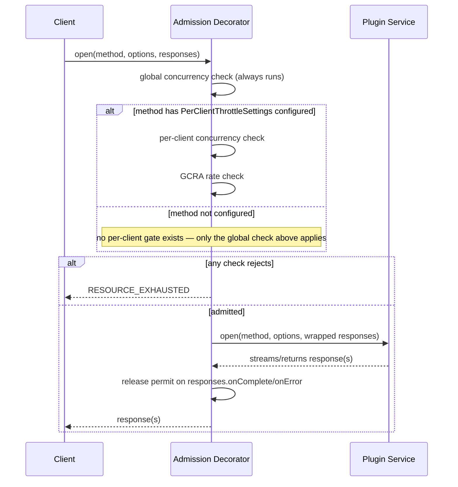
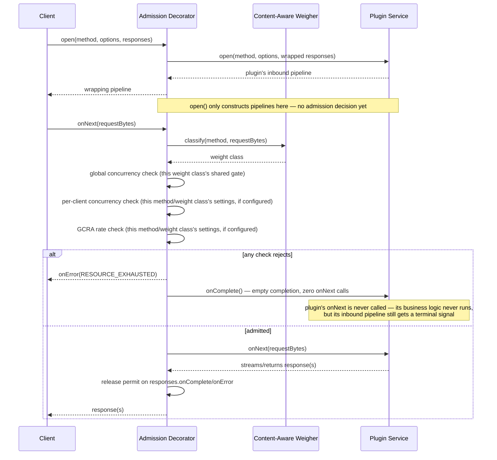
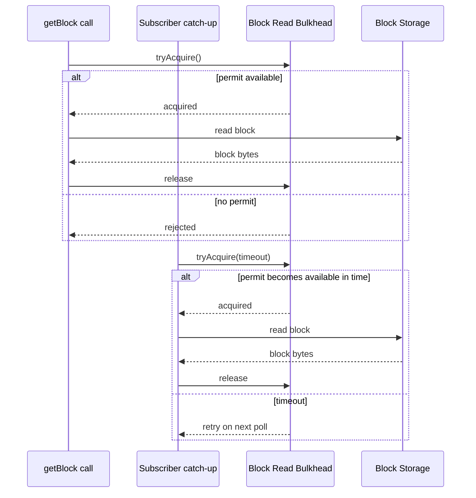

# API Throttling and Admission Control Design

## Table of Contents

1. [Purpose](#purpose)
2. [Goals](#goals)
3. [Terms](#terms)
4. [Entities](#entities)
5. [Design](#design)
6. [Diagram](#diagram)
7. [Configuration](#configuration)
8. [Metrics](#metrics)
9. [Exceptions](#exceptions)
10. [Acceptance Tests](#acceptance-tests)

## Purpose

The Block Node exposes several gRPC APIs with very different resource profiles: `publishBlockStream` (block ingest
from consensus nodes), `subscribeBlockStream` (long-lived streaming reads), `getBlock` (on-demand reads — cheap for
recent blocks, comparatively expensive for archived/historical ones), and lightweight status APIs (`serverStatus`,
`serverStatusDetail`). None of these APIs currently have any rate limiting, per-client concurrency limiting, or
admission control.

This means a burst of read traffic (many concurrent subscribers, or a spike of `getBlock` requests against
historical blocks) has no mechanism preventing it from consuming a disproportionate share of node resources (CPU,
memory, disk I/O, and connection capacity). This document proposes an admission-control layer that applies
per-client rate and concurrency limits to each gRPC API, tuned to how expensive that API's calls actually are, plus
a shared safeguard that protects the block-storage read path from concurrent-read overload regardless of which
client or API triggered it.



## Goals

1. Apply per-client rate and concurrency limits to each gRPC API.
2. Distinguish cost *within* a single API where it matters — e.g. `getBlock`/`subscribeBlockStream` requests for
   live/recent blocks are materially cheaper than requests for historical/archived blocks, and should be limited
   differently.
3. Protect the shared backend block-storage read path from concurrent-read overload, independent of and
   complementary to per-client limits.
4. Fit naturally on top of the Block Node's existing gRPC service layer (`ServiceInterface`), without coupling the
   mechanism to a specific web server (Helidon, Netty, etc.) implementation.
5. Favor a small number of simple, well-understood, proven mechanisms (rate limiting, concurrency limiting) over a
   complex adaptive system.
6. Be performant: admission control must not become a meaningful source of latency or resource consumption itself,
   and must not compromise the Block Node's own low-latency, high-throughput goals for the path it exists to
   protect. See [Performance](#performance) under Design.

**Non-goals for this iteration:**

- **Throttling `publishBlockStream`.** This work exists to protect the ingest path from resource contention caused
  by other APIs, not to further constrain it. Misbehaving-publisher protection (e.g. penalizing a publisher that
  repeatedly sends invalid data) is a separate concern.
- **Authenticated client identity.** No authentication mechanism exists for the read APIs today. Clients are
  identified by network address for now; the identification mechanism is designed to be replaceable without
  reworking the rest of the system. Network address is a best-effort signal, not a reliable identity: any L4+
  router, load balancer, or NAT gateway between a caller and the node can make many independent callers appear
  as one address (CGNAT, corporate NAT, cloud egress gateways) or let one caller cheaply present many addresses
  (source-IP rotation on any cloud provider). Per-address limiting therefore reduces the blast radius of the
  common case (a buggy or greedy single consumer) rather than guaranteeing fairness against a motivated,
  distributed adversary; the identity-agnostic node-wide ceilings (the global concurrency check in
  [Component A](#component-a--per-client-admission-gate) and [`BlockReadBulkhead`](#component-b--shared-backend-block-read-bulkhead))
  are the actual backstop for that threat, and hold regardless of how this per-client signal is defeated.
- **Fully adaptive / self-tuning rate limiting.** A closed-loop controller that automatically discovers sustainable
  throughput is a reasonable future evolution if static limits prove insufficient, but is materially more complex
  to build and operate, and is not warranted without evidence that static, well-tuned limits fall short. The static
  *capacity* knobs specifically (node-wide concurrency ceilings, `BlockReadBulkhead` permits) are a plausible
  exception to this if hardware heterogeneity across deployments makes one hand-tuned default impractical — see the
  adaptive-bulkhead-sizing follow-up under the throttling epic. The hardware heterogeneity consideration applies
  narrowly to capacity sizing, not to per-client policy (rate, burst, per-client concurrency), which stays a static
  fairness choice by design.
- **Priority-aware throttling.** Giving some connections/clients/requests precedence over others under high
  concurrency is out of scope for this iteration. Meaningful prioritization needs a trustworthy client identity to
  assign priority to, so this is better gated on the authenticated-client-identity work above.

## Terms

- **Admission control** — Deciding, at the point a request or stream is opened, whether to accept it now or reject
  it immediately.
- **Client key** — An identifier used to group a caller's requests for the purpose of per-client limits. Derived from
  the caller's network address in this design.
- **Weight class** — A cost tier assigned to a request (today, `STANDARD` or `HEAVY`) that determines which
  rate/concurrency policy applies to it.
- **Content-aware weigher** — A per-API function that inspects a request's content (e.g. the requested block number)
  to classify it into a weight class before admission, rather than relying on a single static weight for the whole
  API.
- **Leaky bucket (rate limiter)** — The rate-limiting model used per client per method: a request adds to a
  conceptual bucket, the bucket drains at a fixed rate, and a request is admitted only if the bucket isn't already
  full. Used strictly as a policer here (reject on arrival), not a shaper (delay and re-admit later); see
  [Alternatives considered](#alternatives-considered). The state representation used to implement this model is an
  implementation choice, not part of the model itself — see [`GcraLimiter`](#gcralimiter).
- **Bulkhead** — A bounded pool of permits that caps how many callers can concurrently use a shared resource,
  independent of whom those callers are.
- **Concurrency permit** — A slot representing one in-flight call or session against a limit; acquired on admission
  and released when the call/session ends.

## Entities

### `PerClientThrottleSettings`

The per-client rate (requests per second), burst tolerance, and concurrency ceiling a plugin declares for one
`(method, weight class)` combination — see [`MethodWeight`](#methodweight). Used directly, unmodified, as the
operative per-client rule; nothing merges or resolves it into a separate runtime type.

### `MethodWeight`

A `(method, weight class)` pair — the key a plugin uses to declare [`PerClientThrottleSettings`](#perclientthrottlesettings)
independently for each method it wants gated, rather than one setting shared by every method on the service. See
["Configuration ownership"](#configuration-ownership) for why a method with no entry still isn't left completely
unprotected.

### `GlobalConcurrencyGate`

The node-wide concurrency ceiling for one `(service, weight class)` combination — shared by every method at that
weight class, configured or not. Deliberately *not* split per method: see
["Client-state bookkeeping"](#client-state-bookkeeping) for why fragmenting it would silently multiply the node's
total allocation for that weight class.

### `GcraLimiter`

A lock-free leaky-bucket rate limiter, keyed per client, implemented via the
[Generic Cell Rate Algorithm](https://en.wikipedia.org/wiki/Generic_cell_rate_algorithm) (GCRA). Holds one
monotonic-clock timestamp (the theoretical arrival time) per key, advanced via compare-and-swap on each admitted
request — deliberately not a token counter, since that would need the same timestamp anyway (to know when to
refill) plus a second field.

### `ClientKeyExtractor`

Derives a client key from an incoming call's connection metadata. The default implementation uses the caller's
remote network address. The interface is designed so an authenticated-identity-based implementation (e.g. an mTLS
client certificate, or an OAuth/bearer-token subject once a token-based auth scheme exists) can replace it later
without changing anything else in the system — the design deliberately doesn't commit to either as the eventual
mechanism.

### `ContentAwareWeigher`

An optional, per-API function that classifies a request into a weight class based on its content. Used by
`getBlock` and `subscribeBlockStream` to distinguish live/recent requests from historical ones. It cannot classify
inside `open()` — request bytes aren't available there — so where one is registered, admission moves to `onNext`;
see [Component A](#component-a--per-client-admission-gate)'s "Content-aware weighting" for the full flow.

### The admission decorator

A wrapper around a plugin's `ServiceInterface` implementation that performs the admission decision on every call
and, if admitted, tracks the call's concurrency permit for its full lifetime.

### `BlockReadBulkhead`

A single, shared, bounded permit pool protecting the block-storage read path. Not keyed by client — it protects the
resource itself, independent of who is reading from it.

### How the entities relate



The `ClientKeyExtractor` interface is deliberately factored out as its own pluggable type rather than inlined into
the decorator, specifically so a future authenticated-identity mechanism (an mTLS client certificate, or an API key)
can be introduced later as a new implementation of this one interface, without changing the admission decorator,
`PerClientThrottleSettings`, or any configuration record. `RequestOptions.remoteCertificateChain()` already exists
on the underlying request options today, unused — it is exactly what a future `TlsCertificateKeyExtractor` would
read from.

Selection is wiring-driven, not configuration-driven: the registration point constructs the extractor directly,
one instance per throttled service, so switching implementations needs a code change and a restart, not a config
change. Each configured `(method, weight class)` owns its own isolated per-client state table (see
["Client-state bookkeeping"](#client-state-bookkeeping)), so two extractors producing the same key for different
callers can only collide within calls to the *same* method, never across methods or services.

## Design



### Where admission control attaches

Every gRPC service implemented by this project's plugins is a PBJ `ServiceInterface`, and every call to any of them
(unary or streaming) passes through exactly one method:

```java
Pipeline<? super Bytes> open(Method method, RequestOptions options, Pipeline<? super Bytes> responses)
```

This is the attachment point for admission control: a decorator wraps a plugin's `ServiceInterface` before it is
registered with the server. `open()` is where the decorator attaches, but not always where the check itself runs:
for most methods it runs synchronously inside `open()`; for `getBlock` and `subscribeBlockStream`, it runs in the
pipeline's `onNext` instead, since classifying a call's weight needs request bytes `open()` doesn't have yet — see
[Component A](#component-a--per-client-admission-gate)'s "Content-aware weighting" for why.

Either way, the plugin's own business logic never runs until admission passes — though for weighted methods, the
plugin's `open()` itself already has, before that decision is made; see "Content-aware weighting" below for why,
and for the constraint that imposes on weighted-method implementations. Because the decorator sits at the
`ServiceInterface` level rather than inside a specific web server's request-routing layer, the mechanism doesn't
depend on which web server hosts the gRPC service.

`RequestOptions` already exposes what's needed for the default client-key extraction (the caller's remote address)
and, if authenticated client identity is introduced later, the caller's certificate chain.

### Component A — per-client admission gate



For every call, in order — the first check that rejects wins, and no later check runs:

1. **Global concurrency check** — reserves a slot atomically (compare-and-swap, not check-then-increment, so
   concurrent callers can never collectively overshoot the ceiling) against the node-wide concurrency ceiling for
   this weight class, via [`GlobalConcurrencyGate`](#globalconcurrencygate). Always runs, regardless of whether this
   method has any per-client configuration.
2. **Per-client concurrency check** — reserves a slot atomically against this client's own concurrency ceiling for
   this method and weight class. **Skipped entirely** for a method with no
   [`PerClientThrottleSettings`](#perclientthrottlesettings) configured — see
   ["Configuration ownership"](#configuration-ownership).
3. **Rate check (leaky bucket, via GCRA)** — is this client calling faster than its allowed rate for this method and
   weight class? This check is the only one that mutates state (it advances the client's theoretical-arrival-time
   marker), so it deliberately runs last. A call that's going to be rejected by a cheaper check must not be allowed
   to consume a rate-limiting slot first. If this check rejects, the two slots reserved above are released. Also
   skipped for an unconfigured method, for the same reason as check 2.

If every check passes, the call is admitted: both concurrency slots reserved above stay held for the call's
duration, and the real service's business logic is invoked. If any check fails, the call is rejected immediately
(see [Exceptions](#exceptions)) and that business logic is never invoked. For `getBlock` and `subscribeBlockStream`, this describes when the admission
*decision* happens, not when the delegate's `open()` runs — their delegate's `open()` always runs immediately,
regardless of the eventual decision, since it runs before the decision is made; see "Content-aware weighting" below
for why, and for the constraint that imposes on weighted-method implementations.

**Overload prevention vs. single-consumer abuse are different guarantees.** The global concurrency check above,
and `BlockReadBulkhead` (Component B), are identity-agnostic: they cap total in-flight work regardless of who's
generating it, so this holds even if every per-client check is defeated (e.g. by IP rotation, per the client-key
caveat above). This is the real, hard backstop against overload. The per-client concurrency and rate checks, by
contrast, are a best-effort deterrent for the common case (a buggy or greedy single consumer) — without an
authenticated identity, they cannot be a guarantee against a motivated, distributed adversary.

**Concurrency-permit lifecycle.** The decorator must release a call's concurrency permit exactly once, whenever the
call ends (noting "the call ends" is not signaled the same way for every RPC shape). The permit must be attached to the
*outgoing* `responses` pipeline (the pipeline passed into `open()`), not the pipeline that `open()` returns. For a
server-streaming call such as `subscribeBlockStream`, the client sends one request and then half-closes its side
almost immediately. This does not mean the call is finished, since the server may continue streaming responses
for a long time afterward. The `responses` pipeline's completion callbacks reliably fire exactly once when the call
actually ends on normal completion, on a business-logic error, or on a deadline being exceeded, for both unary and
streaming calls alike, **with one confirmed exception, below.** The release logic needs its own single-fire guard
regardless, since more than one of those signals can arrive for the same call (for example, a cancellation arriving
immediately after a business-logic error).

**Known gap: cancellation of an idle, half-closed streaming call is not detected promptly.** Once a
server-streaming call's client has half-closed (the normal shape described above) and the call is otherwise idle,
which is the common case for `subscribeBlockStream` waiting on a not-yet-published block, a subsequent client
cancellation or disconnection does **not** trigger `onComplete`/`onError` on the `responses` pipeline. This is a
confirmed limitation of the underlying PBJ/Helidon transport stack, an SPI gap in how Helidon's HTTP/2 stream
handler learns of connection-state changes, and not a defect in this decorator's own logic. It was verified with a
minimal, hiero-block-node-code-free repro against the exact Helidon/PBJ versions this project uses. In this
situation the permit is only released reactively: the next time the plugin attempts to write a response into the
dead pipeline, the write throws and that exception does reach `onError`, or, if no further write is ever
attempted, once the connection's own `idleConnectionTimeoutMinutes` reaper closes the underlying socket. That
reaper is bounded but slow (a multi-hour window at today's default), and even then is only discovered by the
plugin on its *next* write attempt, not proactively. A cancelled-but-abandoned subscription on a quiet chain can
therefore hold its permit well past when the call actually needed it. This does not threaten the node-wide
concurrency ceiling's correctness, since the accounted total never exceeds the configured value, but it can
reduce real available capacity for legitimate clients while a phantom permit is held. Tracked as a general
streaming-resource-lifecycle follow-up in
[#3825](https://github.com/hiero-ledger/hiero-block-node/issues/3825), since the same gap can affect other
resources tied to a streaming call's lifecycle, not just this permit.

**Content-aware weighting for `getBlock` and `subscribeBlockStream`.** A single static weight per API can't express
that a historical block read is more expensive than a live one. Both APIs register a `ContentAwareWeigher` that
classifies the requested block (`getBlock`) or start block (`subscribeBlockStream`) against the boundary below, so
historical requests are checked against a stricter policy. For `subscribeBlockStream` this classification happens
once, at admission — a session that later catches up on history is protected by Component B, not by re-weighing
mid-session.

**The recent/historical boundary** is distance from the tip: a request is historical if it targets a block more
than a configurable `historicalThresholdBlocks` behind the current maximum available block. Queried fresh each
call, not cached — the same accessor is already read unconditionally elsewhere on this path, so this adds no new
cost. `retrieveLatest` and a missing/negative block number are always classified live, avoiding the cost of
resolving "latest" just to weigh the call. The threshold is deliberately decoupled from the recent-storage-tier
plugin's own retention boundary, so the weigher doesn't depend on a specific storage-tier plugin being present —
the two are expected to match, but nothing enforces it.

Because classification needs the request bytes, which aren't available until `onNext`, a weighted method's
`open()` doesn't gate anything — it only extracts the client key and calls the delegate's own `open()` to build its
inbound pipeline, unconditionally, before admission is known. Classification and all three checks then run
together in the wrapping pipeline's `onNext`, before the delegate's `onNext` is called. The outcome matches the
unweighted case (a rejected call's business logic never runs, nothing is charged twice); only the point where that
decision happens moves, from `open()` to `onNext`.

**An unconfigured heavier weight class falls back to `STANDARD`'s own ceiling, including its global gate.** A
weighted method must configure a `STANDARD` entry for every weight class it wants its own ceiling for; if the
weigher classifies a call into a weight class with no matching entry, admission falls back to that method's
`STANDARD` entry — `STANDARD`'s per-client settings *and* `STANDARD`'s node-wide concurrency gate, not a gate scoped
to the classified weight class. Concretely: a historical `getBlock` call on a method configured with only a
`STANDARD` triple is checked against the same ceiling as a live `getBlock` call, not a stricter historical one. This
is a deliberate policy choice — an operator who wants a heavier weight class's own ceiling enforced must configure
it explicitly, rather than getting it by default — not a structural constraint, so it is not a one-way door: a
future change to scope the fallback to the classified weight class's own gate is possible if this default proves
wrong in practice.

**Weighted-method delegates must keep `open()` side-effect-free.** Since the delegate's `open()` always runs before
admission is decided, a weighted method's delegate must not acquire resources, perform I/O, or start any business
logic inside `open()` — only inside its own `onNext`/handler logic, once called. Every current delegate satisfies
this because PBJ's `Pipelines` helper only constructs a `Pipeline` object in `open()`; this is a constraint any
future weighted-method delegate implementation must uphold, not something the decorator enforces or can detect. If
a future delegate's `open()` ever acquired a resource eagerly, a rejected call would strand it, since a rejection
never reaches that delegate's `onNext`.

**A rejected call still completes the delegate's inbound pipeline, without a second terminal to the client.** The
delegate's inbound pipeline already exists by the time a weighted call is rejected (built by its `open()` above),
but a rejection means it will never receive `onNext`. The decorator must not complete that pipeline itself: PBJ's
`Pipelines`-built delegates (both unary and server-streaming) forward their inbound pipeline's `onComplete` straight
through to the `responses` pipeline passed into `open()`, which here is the same pipeline the client-facing
`onError(RESOURCE_EXHAUSTED)` was already sent on. Completing the delegate's inbound pipeline after that would
forward a second terminal signal to the client, violating the single-terminal contract. The wrapper therefore leaves
the delegate's inbound pipeline without any terminal call once a call is rejected; nothing else will ever call it
again, so it needs none.

### Component B — shared backend block-read bulkhead



Component A limits *admission*: how many requests or sessions a given client is allowed to have outstanding. It says
nothing about whether the node currently has spare capacity to actually serve them, and that capacity is shared
across more than one API: both `getBlock` and a subscriber catching up on historical blocks read from the same
underlying block storage. A per-client limit on `getBlock` alone would leave that shared resource unprotected
against combined load from both call paths.

Component B is a single, bounded, non-client-keyed pool of permits guarding every read against block storage:

- `getBlock` acquires a permit without waiting; if none is available, the call is rejected immediately, since this
  is a single request-response exchange from the client's perspective.
- A `subscribeBlockStream` session catching up on historical blocks acquires a permit with a brief bounded wait instead
  of an immediate rejection. A session is a standing resource whose purpose is to keep running; rejecting the whole
  session over one momentary saturation instant is a worse outcome than a short internal delay before retrying.
  This wait is purely internal scheduling for already-admitted work — it never affects the admission decision in
  Component A.

The node-wide concurrency ceiling Component A applies to historical `getBlock` requests should be sized with this
bulkhead's capacity in mind, since both draw from the same underlying resource — but because the bulkhead is also
shared with subscriber catch-up traffic, which that `getBlock` ceiling has no visibility into, sizing Component A's
historical-`getBlock` ceiling and the bulkhead's permit count independently is a reasonable approximation rather than
a guarantee that the bulkhead can never be contended by both sources at once. The bulkhead's own bounded behavior
(reject or brief wait, never unbounded growth) is what keeps that scenario safe even so.

The initial implementation uses one pool for all tiers, including recent/live reads — a `getBlock` call for a live
block acquires and releases a permit the same as a historical one. This is a deliberate simplicity choice, not a
claim that live reads are free of overhead: if warm-path latency sensitivity proves material, a separate bulkhead
for recent reads (or skipping the bulkhead for reads served from an in-memory/warm-file path) is the documented
[Extensibility](#extensibility) point to use.

### Configuration ownership

Each gRPC method has exactly one plugin that implements it, so a client's rate and per-client concurrency limits for
that method are naturally a concern of that one plugin — they require no coordination with any other plugin. Each
plugin therefore declares its own per-client throttle configuration in its own module, following the same pattern
already used for that plugin's other configuration — **one entry per method it wants gated**, not one shared entry
for the whole service. A service with several methods can configure each of them with independent numbers, configure
only some of them, or configure none at all.

A method with no entry (and no [`defaultPerClientSettings`](#extensibility) override — see below) gets **no
per-client gate at all**: nothing tracks that specific client's rate or concurrency for it. It is still subject to
the node-wide concurrency ceiling for its weight class, which is mandatory and always shared — see
["Client-state bookkeeping"](#client-state-bookkeeping). This is a deliberate opt-in model: an operator decides
which methods are worth individually tracking per client, rather than every method on a service being forced into
the same bucket by construction.

A method's node-wide concurrency ceiling is different from its per-client settings: it represents an allocation of
one shared, node-wide capacity budget (connections, heap, disk I/O), which is inherently a node-level view rather
than something any single plugin can reason about on its own. Node-wide ceilings therefore live in one small,
shared, node-level configuration record, one entry per `(service, weight class)` — never one per method, regardless
of how many methods on that service are individually configured with per-client settings at that weight class (see
[`GlobalConcurrencyGate`](#globalconcurrencygate)).

Enforcement stays centralized in the one place that already sees every plugin's service registration: a plugin
hands in its own per-`(method, weight class)` settings at registration time, and the registration point resolves
the corresponding node-wide ceiling independently — the two are never merged into one combined runtime value, since
the ceiling is shared across methods that may each carry different per-client settings (or none at all). This keeps
per-client tuning fully owned by the plugin that the limit governs, while keeping the actual enforcement logic — and
the ability to validate that per-plugin and node-wide numbers agree with each other — in one place.

### Client-state bookkeeping

Per-client rate and concurrency state is held in a bounded, concurrent map keyed by client key only — there is no
method dimension in the key, because **one such map exists per configured `(service, method, weight class)`
combination**, not one shared across a service's methods. Two methods on the same service, configured
independently, get two entirely independent maps — independent rate buckets, independent concurrency ceilings —
even if their configured numbers happen to be identical. A method with no configuration at all has no map: nothing
is tracked per client for it.

`BlockNodeService`'s `serverStatus` and `serverStatusDetail` are both configured today, each with its own map — a
client's traffic on one never affects its allowance on the other. This is different from treating the whole service
as one bucket: it is a deliberate per-method choice (see ["Configuration ownership"](#configuration-ownership)), not
an accident of how many methods happen to share a weight class.

What *is* still shared across every method at a weight class — configured or not — is the node-wide concurrency
ceiling itself, via [`GlobalConcurrencyGate`](#globalconcurrencygate). This is deliberately **not** split per method:
if it were, two independently-configured methods at the same weight class would each carry their own copy of the
ceiling, silently doubling the node's actual total allocation for that tier versus what the configured number says.
Keeping it one shared gate per `(service, weight class)` is what makes "allocation of the node's shared capacity"
in the previous section actually true, regardless of how many methods draw from it or how they're configured.

Left unmanaged, each per-client map's key space would grow without bound as new clients connect over time — which
would recreate, inside the throttling system itself, the same kind of unbounded resource growth this system exists
to prevent. Entries are evicted lazily when a stale entry is encountered on the read path, backed by a
low-frequency full sweep that catches clients who are never looked up again.

### Performance

Admission control must not become a meaningful cost on the request path it protects, and must never add latency or
resource overhead to the one path that stays fully exempt from it (`publishBlockStream`). The design keeps overhead
small and bounded by construction:

- **No blocking, no locks.** The GCRA rate check is a single compare-and-swap loop on one `AtomicLong` per client per
  method; the concurrency checks are reads and atomic increments/decrements on plain counters. None of Component A's
  checks acquire a lock or perform I/O.
- **No extra threads, no extra network hops.** The admission decorator runs synchronously, in-process, on the same
  thread that would have handled the call anyway. It is one additional layer of method dispatch per call, applied
  once at service-registration time — not a new pipeline stage, background thread, or process boundary.
- **`publishBlockStream` carries zero added cost.** Because it is fully exempt, no decorator, no counters, and no
  extra allocation are introduced on the ingest path at all.
- **Two implementation details are worth calling out explicitly, since they are the parts most likely to erode this
  if done carelessly:**
  - **Client-key derivation must stay a cheap, already-resolved-data read.** `ClientKeyExtractor` derives its key
    fresh on every call from `RequestOptions.remoteAddress()` — no DNS lookup, no parsing, just reading data the
    transport already resolved. There's no connection-scoped cache to build here: the default extractor
    deliberately keys by client, not by connection (it strips the port so a client's reconnection still maps to
    the same key — see [`ClientKeyExtractor`](#clientkeyextractor)), and the per-client state map that matters
    already exists with its own TTL-based eviction. Keep any future extractor this cheap; don't introduce a
    second cache alongside the one that already does this job.
  - **Content-aware weighing must not require a full protobuf deserialization.** A weigher only needs to read one or
    two fields (e.g. a block number) to classify a request. It should do a targeted read of that field directly from
    the wire format, not fully deserialize the request message before the real handler does its own full parse —
    otherwise every classified call would pay for parsing the request twice. This is a hand-written read via PBJ's
    `ProtoParserTools` — the same low-level primitives PBJ's generated parsers use, just called directly instead of
    from generated code. Each weigher implements its own read loop today; worth sharing once a third one needs it,
    not before.
- **Acceptance criterion.** This goal should be validated, not assumed: a benchmark comparing per-call latency and
  allocation with admission control enabled versus disabled on the same hardware belongs in the acceptance tests for
  the implementation, not just asserted here (see [Acceptance Tests](#acceptance-tests)).

### Extensibility

Three extension points are designed in from the start, since all three are anticipated future work:

- **Client identification.** `ClientKeyExtractor` is a small, isolated interface specifically so that authenticated
  client identity — an API key, or an mTLS client certificate — can replace network-address-based identification
  later by adding one new implementation, with no change needed to the admission decorator,
  `PerClientThrottleSettings`, or any per-plugin configuration. `RequestOptions.remoteCertificateChain()` already
  exists today, unused, as exactly what a future certificate-based extractor would read.
- **A generous default instead of no per-client gate.** `ThrottleSpec.defaultPerClientSettings()` exists
  specifically for this: empty today (preserving the behavior in
  ["Configuration ownership"](#configuration-ownership) — an unconfigured method gets no per-client gate at all), but
  a plugin can override it later to give every otherwise-unconfigured method a shared, generous default instead.
  That's a config/wiring change for one plugin, not a change to the admission mechanism: any method resolved this
  way gets a real per-client gate, built the same way as an explicitly-configured one, indistinguishable from it at
  call time.
- **Additional bulkheads for other shared resources.** `BlockReadBulkhead` is one instance of a general pattern: a
  bounded, non-client-keyed permit pool guarding a specific shared resource against combined load from every call
  path that uses it. Nothing in the design ties this pattern to block storage specifically — a future resource with
  the same shape of problem (several call paths contending for one constrained backend resource) could be protected
  by a new, independently-named and independently-sized bulkhead instance, following the same shape as
  `BlockReadBulkhead`, without changing Component A at all.

### Alternatives considered

- **A single combined per-client "weighted cost" system instead of two separate components.** Rejected: it would
  couple two concerns that change independently — how many clients exist and how they behave has nothing to do with
  how much backend read capacity the node has — and would make the backend-protection guarantee only as strong as
  every client's individually configured weight, rather than a hard shared ceiling.
- **A classic token bucket with a background refill thread, instead of GCRA.** Rejected: GCRA achieves the same
  smooth rate-limiting behavior with one comparison and one atomic update per call, no background thread, and no
  per-bucket refill bookkeeping.
- **Splitting the weighted admission decision — reject on global/per-client concurrency in `open()`, and defer
  only the rate check to `onNext` once classified.** Rejected: there's no weight-agnostic version of the
  concurrency checks to split off in the first place. `maxConcurrentPerClient` is a field on each weight class's own
  `PerClientThrottleSettings`, and even `maxConcurrentGlobal` is keyed by weight class, shared across every method
  within that class but never pooled across different weight classes. Which ceiling applies is therefore unknown
  until classification happens in `onNext` regardless, so there's nothing coherent to check earlier. Doing this
  anyway would mean inventing a new policy value with no counterpart elsewhere in this
  design, plus a provisional-admit-then-reconcile step once the real class is known: a release-then-reacquire
  window in which a concurrent call can take the freed capacity, transiently exceeding the intended ceiling.
  That doubles the surface area of the permit-release subtlety described above, to save one cheap pipeline
  construction and a targeted few-byte field read — neither of which touches the resource this mechanism
  protects.
- **Queueing or delaying a call briefly instead of rejecting it immediately when a limit is hit.** Rejected for the
  client-facing admission decision: a queue is itself a resource that needs its own bound, timeout, and monitoring,
  which works against keeping this mechanism simple. The one deliberate exception is internal to Component B: a
  subscriber session catching up on history gets a brief bounded wait rather than being disconnected, because
  killing a long-lived session over one transient saturation instant is a worse outcome than a short delay, and this
  wait never affects the admission decision itself.
- **Node-wide concurrency ceilings owned by each plugin, alongside its per-client settings.** Rejected: a ceiling
  represents an allocation of the node's total shared capacity across every API, which requires a node-level view no
  single plugin has on its own. Splitting ownership this way keeps every other per-client setting fully owned by the
  plugin it governs.
- **A fully adaptive, self-tuning controller from the start.** Rejected for the initial delivery: it would require
  an independent controller per API cost tier (since a single latency target does not fit APIs with genuinely
  different cost profiles), and depends on a clean backlog signal this node does not have a single, unified source
  of today. Static, well-tuned limits are simpler to build, reason about, and operate, and can be replaced with an
  adaptive approach later if evidence shows static limits are insufficient.

## Diagram

The flow below is the general case: a method with no `ContentAwareWeigher` (e.g. `serverStatus`) is admitted or
rejected synchronously inside `open()`, before the delegate's `open()` is even called.



A method with a `ContentAwareWeigher` (`getBlock`, `subscribeBlockStream`) cannot follow that flow, because
classification needs request bytes that `open()` doesn't have yet. `open()` instead only builds pipelines — no
admission decision happens there — and the decision moves to `onNext`, once request bytes actually arrive:





## Configuration

Each throttled API's own module declares its per-client settings, one entry per `(method, weight class)` it wants
gated — see [`MethodWeight`](#methodweight):

|         Property         |                                             Meaning                                              |
|--------------------------|--------------------------------------------------------------------------------------------------|
| `ratePerSecond`          | Sustained requests (or, for streaming APIs, new session opens) per second allowed for one client |
| `burstTolerance`         | How far ahead of the even-pacing schedule a client's request may arrive and still be admitted    |
| `maxConcurrentPerClient` | Maximum concurrent in-flight calls/sessions for one client on this method                        |

Where a method's `ContentAwareWeigher` produces more than one weight class, each class gets its own full triple
rather than sharing one — e.g. `getBlock` has independent live and historical per-client configuration — so each
tier's tuning, including how much stricter the historical policy is, stays fully independent. The same independence
applies across methods on one service: `BlockNodeService` configures `serverStatus` and `serverStatusDetail`
separately, each with its own triple, even though both currently use the same numbers. A method with no triple at
all simply has no per-client gate — see ["Configuration ownership"](#configuration-ownership).

A single shared, node-level configuration record holds one node-wide concurrency ceiling per `(service, weight
class)` — e.g. `serverStatus` and `serverStatusDetail` share one ceiling for `BlockNodeService`, even though each
gets its own per-client triple above, since the ceiling represents an allocation of shared node capacity rather than
a single plugin's own concern. `getBlock`'s live and historical ceilings look per-method only because
`BlockAccessService` happens to have one method; the ceiling is still scoped to the service, not the method. A
service with only one weight class has just one ceiling.

The shared block-read bulkhead has its own single configuration value: the number of permits in the pool, informed
by the target deployment's storage characteristics.

`getBlock` and `subscribeBlockStream` additionally share one `historicalThresholdBlocks` value — the recent/historical
boundary described above — rather than each declaring its own copy, so the two cannot independently drift apart on
what counts as historical. The client-state table's entry TTL and sweep interval (see
[Client-state bookkeeping](#client-state-bookkeeping)) are also operator-configurable, node-wide values, not
per-method.

`publishBlockStream` declares no throttle configuration and is not subject to any of the checks above.

## Metrics

Every call outcome — admitted, or rejected by one of the checks that ran for it (see
["Where admission control attaches"](#where-admission-control-attaches)) — is recorded against one counter,
`throttle_calls` (exported as `throttle_calls_total`; the exporter appends that suffix to every counter itself, so
the declared name omits it), labeled by `service`, `method`, `weightClass`, and `outcome`, rather than a separately-named
counter per outcome. Cardinality is identical either way (the same `service × method × weightClass × outcome`
combinations exist regardless of how they're split across metric names); one counter means a query for "total
calls" or "rejection rate" for a given service/method sums one metric name instead of enumerating every outcome's
own metric name — and stays correct if a new rejection reason is ever added, where a hardcoded list of metric names
would not. Labels are resolved from the specific method each call hit — including for an unconfigured method,
admitted only via the shared [`GlobalConcurrencyGate`](#globalconcurrencygate) — so every method remains visible in
metrics independent of whether it has its own per-client gate.

The client-state-table-size gauge is labeled by `service`, `method`, and `weightClass`, with no `outcome` label: it
reflects the size of one configured method's own state table (see
[Client-state bookkeeping](#client-state-bookkeeping)), not any one call's outcome. It only exists for methods that
are actually configured — there is no table, and therefore no gauge, for an unconfigured method.

|             Metric              |                              Type                              |                                                                 Meaning                                                                  |
|---------------------------------|----------------------------------------------------------------|------------------------------------------------------------------------------------------------------------------------------------------|
| `throttle_calls`                | Counter, labeled by `service`/`method`/`weightClass`/`outcome` | Every call to a throttled method, by outcome (`admitted`, `rejected_global_concurrency`, `rejected_client_concurrency`, `rejected_rate`) |
| `throttle_client_state`         | Gauge, labeled by `service`/`method`/`weightClass`             | Number of distinct clients tracked by one configured method's throttle, to catch unexpected growth                                       |
| `block_read_bulkhead_in_use`    | Gauge, unlabeled                                               | Permits currently held from the shared block-storage read bulkhead                                                                       |
| `block_read_bulkhead_available` | Gauge, unlabeled                                               | Permits currently available in the shared block-storage read bulkhead                                                                    |

The `weightClass` label above describes the full, weighted design; it is not yet emitted by either metric today,
since no method has more than one weight class until content-aware weighing lands — the counter and gauge are
currently labeled `service`/`method`/`outcome` and `service`/`method` respectively. Per-client and node-wide
in-flight call counts (referenced by [Acceptance Test](#acceptance-tests) 6) are also not yet emitted as their own
gauges. Both are tracked as follow-ups; in the interim, in-flight counts are derivable from admitted-minus-completed
accounting external to this mechanism.

## Exceptions

A call rejected by any admission check fails immediately with a `RESOURCE_EXHAUSTED` gRPC status and a message
describing which check rejected it; the plugin's real service method is never invoked, and no partial response is
produced. `publishBlockStream` is not subject to any admission check and is unaffected by this feature entirely.

## Acceptance Tests

1. A client exceeding its configured rate limit for a method receives `RESOURCE_EXHAUSTED`; traffic within the limit
   is unaffected.
2. A client exceeding its per-client concurrency limit for a method is rejected without affecting other clients'
   ability to call the same method.
3. The node-wide concurrency ceiling for a method rejects new calls once reached, regardless of which client they
   come from.
4. `getBlock` and `subscribeBlockStream` requests for historical blocks are limited independently of requests for
   live/recent blocks, using the same client's traffic on both tiers.
5. A concurrency permit is released exactly once for a call that completes normally, for a call cancelled by the
   client, and for a call that exceeds its deadline. Verified for a unary call, and for a long-lived streaming
   call cancelled *while actively exchanging data*. For a long-lived streaming call cancelled while idle and
   half-closed (the normal shape for `subscribeBlockStream`), release is verified to happen reactively, either on
   the plugin's next write attempt or via the idle-connection reaper, per the known gap documented under
   [Component A](#component-a--per-client-admission-gate). This test must not assert immediate release for that
   specific case.
6. Sustained subscribe/unsubscribe churn from many clients does not cause per-client or node-wide in-flight counts,
   or the client-state table size, to grow without bound.
7. Concurrent `getBlock` (historical) and subscriber catch-up traffic together are capped by the shared block-read
   bulkhead's permit count, regardless of how that load is split between the two call paths.
8. `publishBlockStream` traffic is entirely unaffected by any of the above, at any load level.
9. A benchmark measuring per-call latency and allocation rate, with admission control enabled versus disabled on the
   same hardware, shows no meaningful regression on throttled APIs and zero measurable overhead on
   `publishBlockStream`.
10. The recent/historical boundary's default (`historicalThresholdBlocks`) tracks the recent-storage-tier plugin's
    own retention boundary closely enough in practice that newly-ingested blocks are not misclassified as
    historical under normal operation, despite the two values not being enforced to stay in sync.
11. Two methods on the same service, each configured with its own `PerClientThrottleSettings`, enforce independent
    per-client rate and concurrency limits — one client exhausting one method's ceiling does not affect its
    allowance on the other.
12. A method with no `PerClientThrottleSettings` configured is never rejected by a per-client limit, but is still
    rejected once the service's shared node-wide concurrency ceiling for its weight class is reached — including
    when that ceiling was reached by a *different*, also-unconfigured method on the same service.
