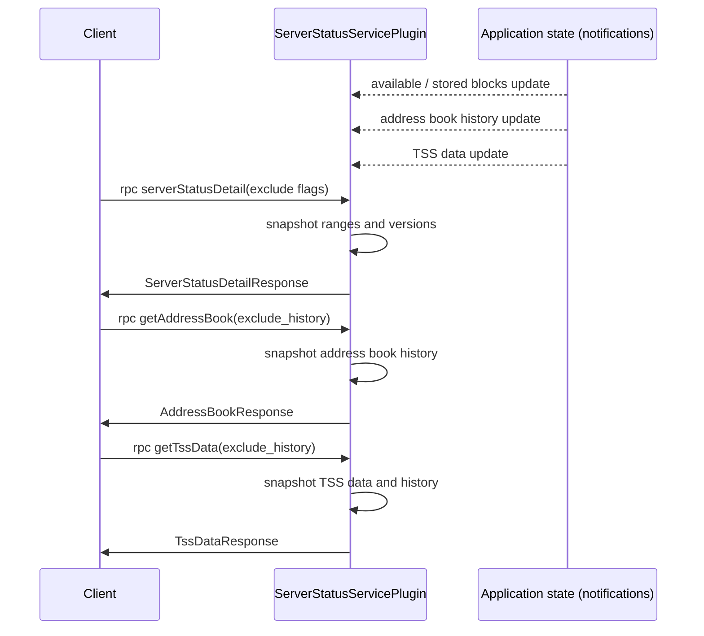

# ServerStatus API Design

## Purpose

The status APIs of the `BlockNodeService` let a client learn what a Block Node can serve and how it is configured:
which blocks it has, which software it runs, and the roster data (address book and TSS) needed to verify blocks.
Clients are Consensus Nodes, Mirror Nodes, other Block Nodes (backfill and roster bootstrap) and operator tooling.

`serverStatusDetail` returns the block serving detail, and a caller can leave out the parts it does not need. The roster
data is large and changes rarely, so it is requested through the dedicated `getAddressBook` and `getTssData` calls.

The protobuf definition lives in `protobuf-sources/src/main/proto/block-node/api/node_service.proto`.

## Goals

1. Keep `serverStatus` as the small, always cheap call for the block range summary.
2. Make `serverStatusDetail` return only block-serving detail, and let the caller leave out the parts it does not need.
3. Provide `getAddressBook` and `getTssData` so roster data is requested explicitly.
4. Let the roster calls return only the most recent values, or the full history by block range.

## Terms

* **Client**: The consumer of the API: a Consensus Node, a Mirror Node, another Block Node or operator tooling.
* **Available ranges**: Block ranges this node can serve to a client.
* **Next expected block**: The next block this Block Node expects from publishers. It is the value set by the publisher
  manager when it accepts a block header, persists a block or resets after a failure. Until the manager has set it, for
  example right after a restart, it is the value the publisher plugin learned when it last answered a publisher with
  `BehindPublisher` (the block in that response + 1). A value below `earliestManagedBlock` is reported as `-1`. After
  startup it is `-1` (accept any block) until one of those events happens; this is the required startup state, it is not
  persisted.
* **Stored ranges**: Block ranges this node has persisted.
* **Address book**: RSA node address book data: node ids and RSA public keys used to verify record-based wrapped blocks.
* **TSS data**: Ledger id, WRAPS verification key and TSS roster information used to verify TSS block proofs.
* **History**: The roster values by block range (for example `RangedAddressBookHistory`), ordered by block number, as
  opposed to only the latest value.

## Entities

### ServerStatusServicePlugin

Implements the `BlockNodeService` RPCs and registers them on the configured gRPC port (the shared `server.port` by
default). It does not read roster data from disk or from other plugins while serving a request. It keeps the latest
values in volatile fields and answers each request from a snapshot of them.

### Application state notifications

The plugin registers an application state notification handler and updates its fields whenever the values change:

- available blocks and stored blocks,
- the latest TSS data,
- the ranged address book history.

The latest address book is derived from the history: the address book of its last era.

### Throttling

Each RPC has its own per-client throttle settings and its own node-wide concurrency ceiling, as described in
[API Throttling](./api-throttling.md). `getAddressBook` and `getTssData` have their own settings, like the other status
RPCs.

## Design

### serverStatus

Returns the first and last available block, the next expected block and whether only the latest state is kept. It is the
call a client should make before requesting block data.

### serverStatusDetail

Returns the version information, the available ranges and the stored ranges. While the roster fields are deprecated it
also returns the TSS data, the latest address book and the address book history.

1. The request is a `ServerStatusDetailRequest` with flags. A flag set to `true` leaves that part out:
   `exclude_versions`, `exclude_available_ranges`, `exclude_stored_ranges`, `exclude_address_book` and
   `exclude_tss_data`.
2. The roster fields (`tss_data`, `node_address_book`, `ranged_address_book_history`) are marked deprecated and are still
   returned until the remove step of [Compatibility and Rollout](#compatibility-and-rollout).
3. After the remove step, the response contains only `version_information`, `available_ranges` and `stored_ranges`, and
   the removed field numbers are marked `reserved` so they are never reused.
4. An empty request returns every part of the response, so a client that sends nothing keeps working.

While the roster fields are deprecated but still returned, `exclude_address_book` and `exclude_tss_data` let a client
leave them out. The address book and its history are the large part of the response. The two flags have no effect once
the fields are removed.

Backfill reads only the available ranges, so it can set the other four flags (versions, stored ranges, address book and
TSS data) and avoid that payload.

### getAddressBook

Returns the RSA address book from the application state.

1. `exclude_history = true`: the response contains only `node_address_book`, the address book of the most recent era.
2. `exclude_history = false` (default): the response also contains `ranged_address_book_history`, the books by block
   range.
3. If no address book is known, the response is valid and the fields are empty. It is not an error.

### getTssData

Returns the TSS data from the application state.

1. `exclude_history = true`: the response contains only `tss_data`, the latest TSS data.
2. `exclude_history = false` (default): the response also contains `ranged_tss_data_history`, ordered by block number.
3. If no TSS data is known, the response is valid and the fields are empty.

The application state keeps only the latest TSS data, so the history is left unset until a ranged TSS history exists
there. See [Design Decisions](#design-decisions).

### Consistency

Each call reads one snapshot of the volatile fields it needs, so a single response is internally consistent. Two separate
calls (for example `getAddressBook` and `getTssData`) are not a single snapshot. Clients that need both must tolerate a
change between them.

## Sequence Diagram



## API Messages

```protobuf
message ServerStatusDetailRequest {
    // If true, the response leaves out version_information.
    bool exclude_versions = 1;
    // If true, the response leaves out available_ranges.
    bool exclude_available_ranges = 2;
    // If true, the response leaves out stored_ranges.
    bool exclude_stored_ranges = 3;
    // If true, the response leaves out node_address_book and ranged_address_book_history
    // (deprecated; still returned by default until they are removed).
    bool exclude_address_book = 4;
    // If true, the response leaves out tss_data
    // (deprecated; still returned by default until it is removed).
    bool exclude_tss_data = 5;
}

message ServerStatusDetailResponse {
    reserved 3, 4, 6; // tss_data, node_address_book, ranged_address_book_history
    BlockNodeVersions version_information = 1;
    repeated BlockRange available_ranges = 2;
    repeated BlockRange stored_ranges = 5;
}

message AddressBookRequest {
    // If true, the response includes only the most recent address book.
    bool exclude_history = 1;
}

message AddressBookResponse {
    NodeAddressBook node_address_book = 1;
    RangedAddressBookHistory ranged_address_book_history = 2;
}

message TssDataRequest {
    // If true, the response includes only the most recent TSS data.
    bool exclude_history = 1;
}

message TssDataResponse {
    TssData tss_data = 1;
    RangedTssDataHistory ranged_tss_data_history = 2;
}

service BlockNodeService {
    rpc serverStatus(ServerStatusRequest) returns (ServerStatusResponse);
    rpc serverStatusDetail(ServerStatusDetailRequest) returns (ServerStatusDetailResponse);
    rpc getAddressBook(AddressBookRequest) returns (AddressBookResponse);
    rpc getTssData(TssDataRequest) returns (TssDataResponse);
}
```

Notes:

- The flag type is the protobuf type `bool`.
- `RangedTssDataHistory` is a list of `RangedTssData` entries, each a `TssData` with a `start_block` and an `end_block`
  (`-1` for the open-ended last entry), the same shape as `RangedAddressBookHistory`.
- The roster fields of `ServerStatusDetailResponse` are marked `deprecated` and are still populated in the first step of
  the rollout below. The `reserved` line above is the final state after the remove step.
- A call whose handler is not available answers `UNIMPLEMENTED`. Clients use that status to fall back to
  `serverStatusDetail`, because any other failure reaches the client as `INTERNAL`.
- `ServerStatusDetailRequest` has only fields that default to `false`. An empty message is wire compatible with an empty
  `ServerStatusRequest`, so existing clients that call `serverStatusDetail` with no arguments are unaffected.

## Compatibility and Rollout

Removing fields from `ServerStatusDetailResponse` affects anything that reads roster data from it. That includes Block
Nodes that query a peer for the address book or TSS data at startup, and operator scripts. Nodes in a network run
different versions at the same time.

Sequence:

1. **Add.** Release the new RPCs and the request flags. The flags let a client that does not need the address book or
   the TSS data leave them out, and `getAddressBook` lets another Block Node query the address book directly. Keep
   populating the roster fields in `serverStatusDetail` until release 0.49, marked deprecated in the proto comments.
2. **Migrate.** Move the roster bootstrap fetchers to the new RPCs. A client falls back to `serverStatusDetail` when a
   peer answers `UNIMPLEMENTED`, so a new node can still bootstrap from an old peer.
3. **Remove.** From release 0.49, stop populating the roster fields and mark the field numbers `reserved`.

Removing the fields in the same release as the new RPCs is simpler, but a new node could not bootstrap its roster from an
older peer. The fields are therefore deprecated first.

## Configuration

Each new RPC has throttle settings that follow the `throttle.serverStatusDetail` pattern, plus a node-wide maximum
concurrency in the global throttle settings:

|                     Setting                      |                 Meaning                  |
|--------------------------------------------------|------------------------------------------|
| `throttle.getAddressBook.ratePerSecond`          | Sustained requests per second per client |
| `throttle.getAddressBook.burstTolerance`         | Burst allowance                          |
| `throttle.getAddressBook.maxConcurrentPerClient` | Concurrent requests allowed per client   |
| `throttle.getAddressBook.maxPermitHoldSeconds`   | Longest time a permit may be held        |
| `throttle.getTssData.*`                          | The same four settings for `getTssData`  |

Both calls return values that change rarely, so their defaults can be lower than the defaults for `serverStatusDetail`.

The `server.status.port` and `server.status.heartbeatPeriodSeconds` settings are unchanged.

## Metrics

|  Type   |                 Name                  |               Description               |
|---------|---------------------------------------|-----------------------------------------|
| Counter | `server_status_requests`              | Number of `serverStatus` requests       |
| Counter | `server_status_details_requests`      | Number of `serverStatusDetail` requests |
| Counter | `server_status_address_book_requests` | Number of `getAddressBook` requests     |
| Counter | `server_status_tss_data_requests`     | Number of `getTssData` requests         |

The counter names for the roster calls follow the naming of the existing counters.

## Exceptions

The plugin does not fail a request because roster data is missing. Missing data is a valid state, for example before the
first roster notification or on a node that has no TSS data, and the response leaves the fields empty. Requests rejected
by throttling use the behavior described in [API Throttling](./api-throttling.md).

## Acceptance Tests

1. `serverStatusDetail` with an empty request returns every part of the response: versions, available ranges, stored
   ranges and the deprecated roster fields.
2. Each exclude flag removes exactly its own part and no other part. `exclude_address_book` removes both the address
   book and its history.
3. `getAddressBook` with `exclude_history = true` returns only the latest address book.
4. `getAddressBook` with `exclude_history = false` also returns the history in block order.
5. `getTssData` behaves the same way for TSS data and its history.
6. Both calls return a valid empty response when no data is known.
7. The new calls are throttled per client and per node with their own settings.
8. The new request counters increment once per request.
9. A client that sends an empty `serverStatusDetail` request keeps working while the roster fields are deprecated.
10. During the migration step, a client falls back to `serverStatusDetail` when a peer does not implement the new calls.

## Design Decisions

1. **Rollout.** Deprecate the roster fields in `serverStatusDetail` until release 0.49, migrate clients with a fallback, then
   remove them. This is the safe choice for networks that run mixed versions.
2. **TSS history.** `getTssData` returns only the latest TSS data until the application state keeps a ranged TSS history.
   `RangedTssDataHistory` is defined so the response can carry it later.
3. **Flag defaults.** All flags default to `false`. Inverted defaults would make the empty request that an older backfill
   peer sends come back without `available_ranges`.
4. **Excluding roster data.** Deprecated means scheduled for removal, and the fields are still returned by default. The
   `exclude_address_book` and `exclude_tss_data` flags let a client leave them out in the meantime, so the large address
   book payload is optional immediately.
