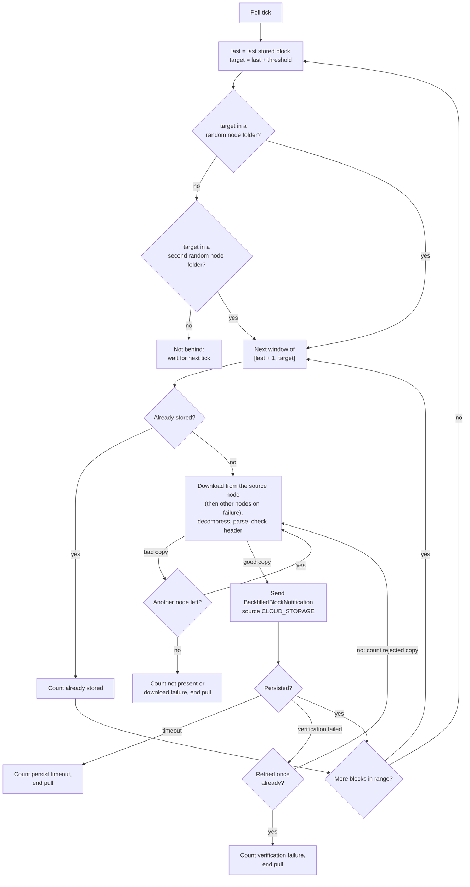
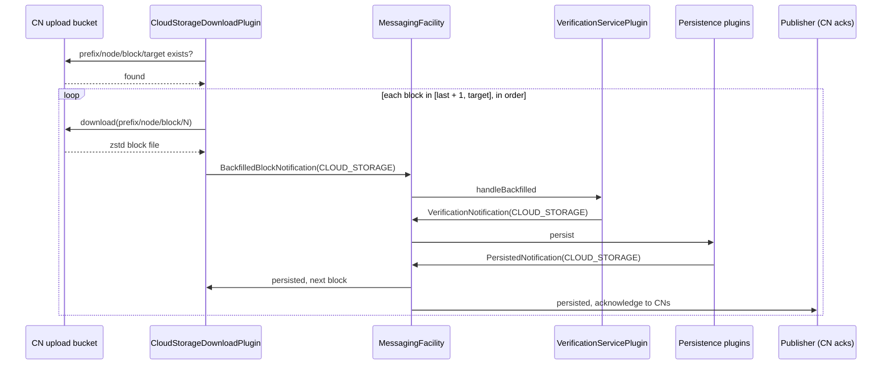

# Cloud Storage Download Plugin

## Purpose

The `cloud-storage-download` plugin observes a cloud bucket where Consensus Nodes (CNs) upload
block files, detects when this node has fallen behind the network, such as when streaming from
the CNs fails for long enough that their buffers fill, downloads the missing blocks, and submits
them to the existing internal verification path.

CNs can upload each finished block file to a cloud bucket in addition to streaming to block
nodes, for example for disaster recovery. Such a bucket is then a valid recovery path for any
block node that receives the stream from CNs, whatever its tier. The plugin runs inside these
block nodes and frequently checks the bucket. When the bucket is ahead of what this node has by
more than a configurable number of blocks, it downloads one valid copy of each missing block. It
then submits the blocks to the same verification and storage path backfill uses. Every pull is
recorded with clear metrics, so we can see when streaming failed and never mistake a recovered
period for a healthy one.

This must not change behavior for subscribers of a Tier 1 BN, and it is a separate plugin; the
backfill plugin is not modified.

## Goals

* The plugin must detect that this block node is behind the network by a configurable number of
  blocks, using only the CN upload bucket.
* The plugin must pull from the bucket whenever the node is behind by the threshold, whether or
  not a peer block node could supply the missing blocks. It never contacts peer block nodes;
  fetching from peers stays the job of the backfill plugin.
* The plugin must deliver the missing blocks strictly in block order, through the same
  verification and persistence path that backfilled blocks use.
* The plugin must tolerate a bad, missing or late copy in one CN's folder by trying another CN's
  copy of the same block.
* Blocks pulled from the bucket must be distinguishable from publisher and backfill blocks in
  notifications, metrics and logs, so that every recovery is visible to operators.
* The plugin must never write to or delete from the bucket, and must work with read-only
  credentials, which operators are expected to use.
* The plugin must be restart-safe without any local state of its own.
* A failure of the plugin or of the bucket while the node runs must never stop the publisher,
  backfill, any other plugin or the server. Whether it makes the block node unhealthy is for the
  health plugin to decide.
* The plugin has no switch of its own: loading it with bucket settings turns it on. A node that
  does not load it is unaffected. A node that loads it without bucket settings starts, and the
  plugin stays idle. A node that loads it with an invalid numeric setting fails to start.
* The plugin must work with any S3-compatible store, including Google Cloud Storage through S3
  interoperability.
* The probe block of each pull must be persisted within 30 seconds of its consensus timestamp.
  This is the provisional latency SLO from the epic; the Mirror Node's own failover spike (10 to
  20 seconds) uses part of the same budget. Earlier blocks of the pull range are older by design,
  since the plugin acts only once the node is `aheadThresholdBlocks` behind.

## Terms

* **CN upload bucket**: The read-only bucket the consensus nodes upload their block files to.
  Owned and operated outside the block node.
* **Network folder**: The top folder of the bucket for one network, `<prefix>`: the network name,
  followed by the time of the last reset on networks that reset (for example `mainnet`,
  `testnet-202611011200`).
* **Node folder**: The part of the network folder written by one consensus node:
  `<prefix>/<node-id>/`.
* **Copy**: One CN's upload of a given block, found at that block's key inside that CN's node
  folder. Every CN uploads its own copy of every block.
* **Last stored block**: The highest block number this block node has stored, from any source
  (publisher, backfill or this plugin). Taken from the Application State facility.
* **Threshold**: How many blocks behind the network the node must be before the plugin acts
  (`aheadThresholdBlocks`). Always below the CN buffer limit.
* **Probe**: The check run every poll interval: does the block file of block
  `last stored + threshold` exist in the bucket?
* **Probe block (target)**: `last stored + threshold`, the block the probe looks for.
* **Pull range**: `[last stored + 1, target]`, the blocks downloaded and submitted once the probe
  finds the probe block.

## Entities

### `CloudStorageDownloadPlugin`

Implements `BlockNodePlugin`, `BlockNotificationHandler` and the application state notification
handler. Owns a single-thread scheduled executor that runs the probe, the download and the
submission. Downloads within one window run in parallel on virtual threads.

### `CloudStorageDownloadConfig`

`@ConfigData("cloud.storage.download")` record holding every setting listed under
[Configuration](#configuration). Credentials are not `@Loggable`.

### Bucket access

The plugin uses `com.hedera.bucky.S3Client` directly, with no wrapper interface. It calls only
bucky's read methods, never an upload or delete method. The existence check uses
`listObjectsPage(key, null, null, 1)` and counts only an exact key match. The download uses
`openObjectStream(key)`, which returns `null` when the object does not exist and throws
`S3ResponseException` only for other errors.

Tests exercise bucket behavior against a real S3-compatible store (RustFS), where missing,
corrupt and late objects are simply staged in the bucket. Where a unit test needs a failure that
is hard to stage, it stubs `S3Client` with Mockito, which can mock final classes.

### `BlockSource.CLOUD_STORAGE`

A new value of the `BlockSource` enum, carried on every notification about a block that came
from the bucket. See [Block source](#block-source).

### `BackfilledBlockNotification`

Gains a `source` field. The existing two-argument constructor defaults it to `BACKFILL`, so the
backfill plugin is not changed.

## Design

### Bucket layout

Each block is stored at:

```
<prefix>/<node-id>/block/AAAA/BBBB/CCCC/DDDD/EEE.blk.zstd
```

* `<prefix>` is the network folder and comes from `objectKeyPrefix`, the same property the other
  cloud plugins have. It is the network name, followed by `-yyyyMMddHHmm`, the time of the last
  reset, on networks that reset: `mainnet`, `testnet-202611011200`. Empty means no prefix.
* `<node-id>` is the ID of the consensus node that uploaded the block.
* `block` is a fixed folder name.
* The remainder is exactly the `cloud-storage-expanded` per-block layout.

For example, block `108273182` uploaded by node `3` on a testnet last reset on 1 November 2026 at
12:00 is `testnet-202611011200/3/block/0000/0000/0010/8273/182.blk.zstd`.

The plugin does not discover the network folder. A reset starts a new network folder, and the
operator sets `objectKeyPrefix` to it as part of the reset. A block node is reset along with its
network anyway, since its stored blocks belong to the old chain. If the prefix is not updated,
the plugin reads the old network folder. Its blocks are expected to fail verification against the
new network's ledger id, and once the new chain passes the old chain's last block the probe finds
nothing, so the plugin never catches the node up.

The object is the CN's TSS-signed block file, unmodified: a protobuf `Block`, compressed with
zstd. The block node already reads this format (`CompressionType.ZSTD`).

A block file that exists in the bucket is complete. The uploader writes each block file with a
single PUT, and S3 and GCS never show a partially written object: a reader sees either no object
or the whole object at the key. S3 and GCS are also strongly consistent, so an object is visible
to reads and listings as soon as the PUT returns. After the PUT the uploader compares the
object's ETag with the MD5 of the local file and deletes the local file only when they match; on
a mismatch it keeps the file and uploads it again over the same key. Until it does, the object in
the bucket may be corrupt. Such a copy fails to parse, has the wrong block number or fails
verification, and the next poll pulls the block again.

The plugin never walks the bucket. It builds keys only for node IDs it already knows.

### Where the inputs come from

All inputs come from the Application State facility; the plugin keeps no state on disk.

* **Last stored block:** the end of the highest range in `storedBlocks()`, kept current from
  `StoredBlocksNotification`. `-1` when nothing is stored. Because it includes blocks from every
  source, a block that backfill already fetched is never pulled again. Gaps below the last
  stored block are left to backfill.
* **Node IDs:** `node_id` of every entry in `tssData().currentRoster()`, read in `start()` and
  refreshed on every `TssDataNotification`, so a node added at an upgrade is picked up. On a
  network without TSS data, the address book history gives the node IDs instead.

### Probe

Once per `pollIntervalMs`:

1. `last` = last stored block.
2. `target = last + aheadThresholdBlocks`.
3. Pick a random node ID and check whether the block file of `target` exists in that node folder.
   The check lists the bucket with the block's key as the prefix and a limit of one key, and
   counts only an exact match, so it does not start a download of the block. If the block is not
   there, try one more random node, since a single slow or failed CN must not hide that this node
   is behind.
4. Not found: the node is not behind by the threshold. Wait for the next poll.
5. Found: the node is behind. Download and submit the pull range, whether or not backfill is
   fetching the same blocks from a peer. When the pull range is done, probe again at once rather
   than waiting for the next poll, since `last` has moved and the bucket may still be ahead. That
   probe starts after the end of the pull, even before the stored blocks report it, so the same
   range is not pulled twice.

The plugin never tries to find the bucket's latest block. S3 and GCS list only in ascending key
order, so that would need a walk of every node folder on every poll. Asking "is the probe block
there?" costs one request per node folder checked. After a pull a tail shorter than the threshold
can remain; that tail is left to the publisher and backfill, since the CNs still hold those
blocks.

### Download and fallback

The whole pull range is downloaded from the node folder in which the probe found the probe block
(the source node). That CN has uploaded at least up to `target`, so its folder most likely holds
every block in the range. Other node folders are used only for a block the source node cannot
supply.

The pull range is processed in windows of `downloadWindow` blocks. For each block:

1. Skip it if the stored ranges already contain it (the publisher or backfill got there first)
   and count it as already stored.
2. Download the copy from the source node, decompress it, parse it as `BlockUnparsed`, and check
   that the first item is a block header with the expected block number.
3. If the copy is missing or unusable (missing object, bad zstd, parse error, wrong number), log
   at DEBUG with the node ID and reason, count a rejected copy (except a plain 404), and try the
   same block in the other node folders, one at a time, until one supplies a usable copy. A
   request that times out or fails with an S3 error is not a bad copy: it counts a request
   failure and ends this pull (see [Exceptions](#exceptions)), since the bucket itself is likely
   stalled.
4. If no node folder supplies a usable copy, count the block as not present when no folder had
   the object at all, otherwise as a download failure, and end this pull. The next poll starts
   again from the new last stored block.

A fallback applies only to the block that needed it; the next block is again downloaded from the
source node.

Downloads within a window run in parallel; their results are submitted strictly in block order.

These checks only filter copies that are obviously broken, so that verification sessions are
not wasted on them. Proof and chain verification stay in the verification plugin.

### Submit and wait

For each downloaded block, in order, the plugin sends

```java
new BackfilledBlockNotification(blockNumber, block, BlockSource.CLOUD_STORAGE)
```

and waits for a successful `PersistedNotification` for that block number before moving on, the
same way backfill waits for each chunk. Any source ends the wait: if the publisher or backfill
persists the block first, the plugin does not wait for its own copy. Within a pull the plugin
never resends a submission, since a resend would race the first one through verification.

The wait is bounded by `persistWaitTimeoutMs`. If the block is not persisted by then, the plugin
logs it, counts a persist timeout, and ends the pull, so a lost notification cannot park the
poll thread for good. The next poll recomputes `last` from the stored blocks: a block that
persisted late is skipped as already stored, and only a block that really never came back is
submitted again.

The plugin always submits in order and waits for each block, whatever the verification
configuration, since the publisher never acknowledges past a gap (see
[Acknowledgement](#acknowledgement)). This also keeps the plugin within the verification plugin's
active session buffer and satisfies its result ordering, which applies to sources other than the
publisher when `verification.allSourcesRequireOrdering` is `true` (the default). It also handles
block 0 correctly, which must persist before later blocks.

If verification fails for a `CLOUD_STORAGE` block, the plugin first checks the stored ranges.
If the block is stored by now, another source persisted it in the meantime: the plugin counts it
as already stored and moves on. Otherwise it counts a rejected copy and retries that block once
from a different node's copy, since the copy may be bad. If that fails too, it counts a
verification failure and the pull ends.

### Acknowledgement

The plugin sends nothing to the CNs. The publisher acknowledges every successfully persisted
block whatever its source, so a block pulled from the bucket is acknowledged on the publish API
once it is persisted, like a block that arrived from a publisher or from backfill. The
acknowledgement goes to every connected CN, and each CN can then drop that block and the ones
before it from its buffer.

The publisher never acknowledges past a gap. This is why the plugin submits the pull range in
order, starting at `last stored + 1`, and waits for each block to be persisted before submitting
the next: each block it pulls moves the acknowledgement forward by one.

### Block source

Bucket blocks reuse the backfill notification, so the plugin needs no new ingest path, but they
carry a new `BlockSource.CLOUD_STORAGE` instead of `BACKFILL`:

* `VerificationServicePlugin.handleBackfilled` takes the source from the notification instead
  of hard-coding `BACKFILL`, and accepts only `BACKFILL` and `CLOUD_STORAGE`.
* `BlockSessionHandler` treats `CLOUD_STORAGE` like `BACKFILL` and passes the source through to
  the verification and persisted notifications.

`BACKFILL` cannot be reused. The backfill plugin reacts to every `BACKFILL` persisted and
verification notification: it counts each one as a backfilled block, and on failure it queues
the block to fetch again from peers. Tagged as `BACKFILL`, every bucket pull would be reported
as a backfill, hiding the very publisher failure the plugin exists to reveal, and every bad CN
copy would send backfill chasing peers for it.

With the new value no other plugin changes:

* The publisher acknowledges bucket blocks like any other persisted block (see
  [Acknowledgement](#acknowledgement)), advances its cursor past them, and reacts to failures
  only for `PUBLISHER` blocks.
* Backfill ignores `CLOUD_STORAGE` blocks.
* The persistence and archive plugins pass the source through.

### Duplicates

When streaming resumes, the publisher and the plugin may deliver the same block, and backfill
and the plugin may too, since the plugin pulls even while backfill fetches the same blocks from
a peer. The plugin skips blocks already stored before downloading them, which avoids most
duplicates. A block another source persists after that check is still submitted. A valid copy is
verified and written again, identical to the first. A failed one (for example a session evicted
from the verification buffer) is recognized by the stored-ranges check above and counted as
already stored, not as a bad copy, so the pull continues. No extra coordination is needed.

### Restart

The plugin keeps no cursor. Every probe recomputes `last` from the stored ranges, so after a
restart it continues from wherever storage is, whichever source stored the blocks. A cursor file
would only duplicate what storage already knows.

### Slow or failing storage

Cloud behavior differs: S3 has been seen to blip past 5 minutes, GCS up to about 90 seconds. The
plugin runs on its own executor with a per-request timeout. A stalled or failing bucket is
counted in `cloud_download_request_failures`, logged and retried on the next poll. It never shuts
the server down and never stops the publisher or backfill: the plugin is a safety net, not a
load-bearing part of ingest.

### Logging

Each pull logs one INFO line when it starts (`last`, `target`) and one when it ends (range
pulled, block count, duration). Per-block detail is at DEBUG or TRACE. Block numbers and
timestamps cannot be metric labels, so these log lines are the record of exactly which blocks
were pulled and when. Levels follow `docs/logging-guidelines.md`.

### Configuration validation

The plugin is turned on by listing `cloud-storage-download` in the node's plugins and giving it
bucket settings; there is no `enabled` property. This follows the `cloud-storage-expanded`
plugin, so a node that loads every plugin starts without download settings.

`init()` checks that `bucketName`, `endpointUrl`, `regionName`, `accessKey` and `secretKey` are
not blank. If any of them is blank, it logs a WARNING naming each blank setting (never a value),
schedules no poll, and the plugin stays idle for the life of the node.

If all of them are set but the bucky client cannot be built from them, `init()` logs a WARNING
and the plugin stays idle in the same way, as `cloud-storage-expanded` does.

Every numeric setting must be at least 1. Like the numeric settings of the other cloud storage
plugins, this is enforced by the configuration itself, so a value of zero or less makes the node
fail to start before the plugin is initialized.

Problems only the bucket can reveal, such as wrong credentials, a missing bucket or an
unreachable endpoint, are not checked at startup. They show up as request failures (see
[Slow or failing storage](#slow-or-failing-storage)) and are retried on the next poll, so a
bucket outage at startup does not stop the node.

## Diagram

### Poll loop



### Block path through the node



## Configuration

All properties are under the `cloud.storage.download` namespace.

|        Property        | Default |                                           Description                                           |
|------------------------|---------|-------------------------------------------------------------------------------------------------|
| `endpointUrl`          | `""`    | S3-compatible endpoint, for example `https://storage.googleapis.com` for GCS. Required.         |
| `regionName`           | `""`    | Region of the bucket. Required.                                                                 |
| `bucketName`           | `""`    | Name of the CN upload bucket. Required.                                                         |
| `accessKey`            | `""`    | Read-only access key (HMAC key for GCS). Not logged. Required.                                  |
| `secretKey`            | `""`    | Read-only secret key. Not logged. Required.                                                     |
| `objectKeyPrefix`      | `""`    | The network folder, `<prefix>` in `<prefix>/<node-id>/block/<archive>`. Changes at every reset. |
| `pollIntervalMs`       | `10000` | Time between probes.                                                                            |
| `aheadThresholdBlocks` | `10`    | The probe block is `last stored + this`. Must be positive and below the CN buffer limit.        |
| `downloadWindow`       | `10`    | Blocks downloaded in parallel before being submitted in order. Must be positive.                |
| `requestTimeoutMs`     | `10000` | Timeout for one bucket request.                                                                 |
| `persistWaitTimeoutMs` | `90000` | How long to wait for the persisted notification of one block before ending the pull.            |

The defaults of `aheadThresholdBlocks` and `pollIntervalMs` are a starting point, to be refined
through testing in real environments. A threshold below 10 is too aggressive: the plugin would
act before the CNs and the publish protocol have had time to recover on their own, weakening the
guarantees the publish protocol gives. A larger threshold or a longer poll interval gives them
more time, at the cost of a longer catch-up and of the latency goal. When tuning them:

* A probe can find the node behind up to one poll interval after it crossed the threshold, and
  that delay comes out of the margin left before the CN buffer fills. The poll interval must
  therefore stay below `(CN buffer limit - threshold) x block time`.
* The poll interval and the persist round trip of every block in the pull range come out of the
  30 second latency budget, so the threshold bounds the pull's duration as well as the CN buffer
  margin.

The following are deliberately not configuration:

* The archive path layout, which is the same as the `cloud-storage-expanded` plugin's.
* The `block` folder name, which is fixed by the CN uploader's format.
* The node IDs, which come from the roster.
* Retry policy details, which use bucky's default `RetryPolicy`.

Credentials can also be supplied as environment variables (`CLOUD_STORAGE_DOWNLOAD_ACCESS_KEY`,
`CLOUD_STORAGE_DOWNLOAD_SECRET_KEY`), like the other cloud plugins.

## Metrics

All metrics are registered under the `blocknode` category. The exporter appends `_total` to
counters, so the keys below do not end in it.

|                 Metric                  |  Type   |                                                   Description                                                   |
|-----------------------------------------|---------|-----------------------------------------------------------------------------------------------------------------|
| `cloud_download_blocks`                 | counter | Blocks of a pull range by outcome, labeled `result` (see below).                                                |
| `cloud_download_copies_rejected`        | counter | Copies discarded: bad zstd, parse error, wrong block number, or failed verification.                            |
| `cloud_download_request_failures`       | counter | Bucket requests (probe or download) that timed out or failed with an S3 error; a plain 404 is not counted.      |
| `cloud_download_copies_downloaded`      | counter | Copies downloaded in full, usable or not.                                                                       |
| `cloud_download_copy_latency_ns`        | counter | Total time spent downloading those copies, in nanoseconds.                                                      |
| `cloud_download_probe_block_latency_ms` | gauge   | For the last pull that persisted its probe block: persistence time minus the probe block's consensus timestamp. |

`cloud_download_blocks` is incremented once per block, when the plugin is done with it:

|       `result`        |                                           The block                                            |
|-----------------------|------------------------------------------------------------------------------------------------|
| `persisted`           | Was persisted from the bucket copy (a persisted notification with source `CLOUD_STORAGE`).     |
| `already_stored`      | Was stored by another source, before download, during the wait or after a failed verification. |
| `not_present`         | Had no object in any node folder.                                                              |
| `download_failed`     | Had objects, but no usable copy.                                                               |
| `verification_failed` | Failed verification for two copies and was not stored by another source.                       |
| `persist_timeout`     | Was not persisted within `persistWaitTimeoutMs`.                                               |

The last four end the pull. Blocks the pull never reached, because it ended early or a bucket
request failed, are not counted. `copies_rejected` and `request_failures` stay separate counters
because they count copies and requests, not blocks.

`cloud_download_blocks{result="persisted"}` is the recovery signal: streaming from the CNs failed
and the bucket filled the gap, so any non-zero value deserves an alert and an explanation.

The average download time of a copy is the rate of `cloud_download_copy_latency_ns` divided by
the rate of `cloud_download_copies_downloaded`, the same pattern as the `cloud-storage-expanded`
upload latency. The metrics library has no histogram type, so percentiles such as P90 are not
available; they can be added once it does.

`cloud_download_probe_block_latency_ms` measures the latency goal. The consensus timestamp comes
from the probe block's header, so it needs no extra request. A pull that ends before its probe
block is persisted leaves the gauge unchanged. An alert on this gauge staying above 30000 shows
that a pull missed the 30 second goal.

The epic also lists a gauge of how far the bucket is ahead of this node. It is not measured: the
plugin only checks whether the probe block exists and never looks for the bucket's latest block,
so that distance is unknown.

## Exceptions

|                 Condition                 |                                                     Handling                                                     |
|-------------------------------------------|------------------------------------------------------------------------------------------------------------------|
| Required bucket setting blank             | WARNING naming the setting, never its value; no poll scheduled; the plugin stays idle and the node starts.       |
| Numeric setting below 1                   | Configuration build fails naming the setting; the node does not start.                                           |
| bucky client cannot be built              | WARNING; no poll scheduled; the plugin stays idle and the node starts.                                           |
| 404 for a block in one node folder        | Not an error; try the next node folder.                                                                          |
| Bad zstd, parse error, wrong block number | DEBUG; `copies_rejected` incremented; try the next node folder.                                                  |
| No node folder has a usable copy          | Block counted as `not_present` or `download_failed`; pull ends; next poll starts again.                          |
| Request timeout or S3 error               | `request_failures` incremented and logged; pull ends; next poll starts again. Never propagated to other plugins. |
| Verification fails for a pulled block     | `copies_rejected` incremented; retried once from another node folder; then `verification_failed`, pull ends.     |
| No persisted notification in time         | Block counted as `persist_timeout` and logged; pull ends; next poll starts again from the last stored block.     |
| `RuntimeException` in the poll task       | Caught and logged at WARNING so the scheduled task keeps running.                                                |

Once the node has started, the plugin is fault-isolated: nothing it does can stop the publisher,
backfill or the server. The block node has no per-plugin health status yet; until it does, the
plugin's state is visible through its logs and metrics (`cloud_download_request_failures`, the
idle WARNING).

## Acceptance Tests

### Unit

1. **Key layout:** block `108273182`, node `3`, prefix `testnet-202611011200` gives
   `testnet-202611011200/3/block/0000/0000/0010/8273/182.blk.zstd`; an empty prefix gives no
   leading `/`; the archive part matches the examples in the `cloud-storage-expanded` design
   (blocks `1`, `1234567` and `108273182`).
2. **Configuration validation:** each blank required bucket setting makes `init()` return
   normally, log one WARNING naming the setting with no credential value, and schedule no poll. A
   zero threshold and a zero window each make the configuration build fail, naming the setting.
3. **Client construction:** settings bucky cannot build a client from make `init()` return
   normally, log a WARNING and schedule no poll.
4. **Nothing stored yet:** with `last = -1` the probe block is `threshold - 1`.
5. **Not behind:** probe block absent in two node folders; no pull.
6. **Behind by exactly the threshold:** probe block present; the pull range is
   `[last + 1, last + threshold]`, submitted in order.
7. **One node folder missing the probe block:** the second random node finds it.
8. **Roster update:** a `TssDataNotification` adding a node makes its folder eligible.
9. **Back-to-back pulls:** after a pull completes and the bucket is still ahead, the next probe
   runs at once.
10. **Backfill sources registered:** with peer block nodes registered as backfill sources, a
    probe that finds the probe block still pulls the whole pull range.
11. **Source node:** every block of the pull range is downloaded from the node folder in which
    the probe found the probe block.
12. **Fallback:** the source node's copy is corrupt, has the wrong block number, or is missing;
    another node's copy is used for that block only, and the next block comes from the source
    node again. All copies bad gives `result="download_failed"` and ends the pull; the object
    missing from every folder gives `result="not_present"`.
13. **Already stored:** a block stored by the publisher during the pull is skipped and counted
    as `already_stored`. A block the publisher persists after the plugin submitted it ends the
    wait and is counted as `already_stored`, not `persisted`; a verification failure for it is
    counted as `already_stored`, not `verification_failed`.
14. **Verification failure:** the block is retried once from another node and the first copy is
    counted as rejected; a second failure counts `verification_failed` and ends the pull.
15. **Persist timeout:** a persisted notification later than `persistWaitTimeoutMs` ends the pull
    without a second submission and counts `persist_timeout`; when the notification arrives
    before the next poll, that poll skips the block as `already_stored`.
16. **Metrics:** each `result` value moves as described in scenarios 5 to 15, each block of a
    finished pull is counted exactly once, blocks after the point where a pull ended are not
    counted, and a stubbed request timeout or S3 error increments
    `cloud_download_request_failures` while a 404 does not. Every copy read in full, usable or
    not, increments `cloud_download_copies_downloaded` and adds its time to
    `cloud_download_copy_latency_ns`. `cloud_download_probe_block_latency_ms` is set from the
    probe block's consensus timestamp when its persisted notification arrives, and stays
    unchanged by a pull that ends before that.
17. **Verification source:** a `CLOUD_STORAGE` backfilled notification yields verification and
    persisted notifications carrying `CLOUD_STORAGE`; the backfill plugin ignores them; the
    publisher acknowledges them.

### Integration (RustFS)

Each test runs the real plugin against a RustFS container. The bucket holds node folders for
three node IDs, seeded by the test with zstd blocks in the expanded per-block layout, and the
plugin is given a roster with those three IDs. The stored blocks are preset by the test, and a
test messaging facility answers every submission with a successful persisted notification and
records the order of submissions. Real verification is not part of these tests; it is covered by
unit test 17 and the end-to-end tests.

18. **Existence check:** for an object that exists, the one-key listing returns its key; for a
    key that does not exist, it returns no exact match rather than throwing. `openObjectStream`
    returns `null` for a missing key rather than throwing.
19. **Not behind:** the bucket holds blocks only up to `last + threshold - 1`. After several polls
    no block has been downloaded or submitted.
20. **Pull from the source node:** all three folders hold `[last + 1, target]`. Every block is
    downloaded from the folder in which the probe found `target`, and the blocks are submitted
    in order. `cloud_download_blocks{result="persisted"}` equals the size of the pull range.
21. **Fallback for one block:** in the source node's folder one block is corrupt and another is
    missing. Those two blocks come from another folder, every other block from the source node,
    and all are submitted in order. `cloud_download_copies_rejected` is 1.
22. **All copies bad:** one block is corrupt in every folder. The blocks before it are
    submitted, that block and the ones after it are not, and
    `cloud_download_blocks{result="download_failed"}` is 1. With the block missing from every
    folder instead, `result="not_present"` is 1. Either way the next poll starts again from the
    last stored block.
23. **Key prefix and probe:** with a non-empty `objectKeyPrefix` and with an empty one, blocks
    are found at the right keys. Blocks under another network folder are not found. An object
    whose key only starts with the probe block's key (for example a `.tmp` suffix) is not
    treated as the probe block.
24. **Slow store:** a Toxiproxy proxy in front of RustFS adds latency above `requestTimeoutMs`.
    Requests time out, `cloud_download_request_failures` increases, no exception escapes the
    plugin, and once the latency is removed the next poll pulls normally.
25. **Stopped store:** the RustFS container is stopped during a pull. The pull ends,
    `cloud_download_request_failures` increases, no exception escapes the plugin, and after the
    container is restarted the next poll resumes from the last stored block.
26. **Bucket problems at startup:** wrong credentials, a missing bucket and an unreachable
    endpoint each increase `cloud_download_request_failures` and log a WARNING. No exception
    escapes `start()`, the node keeps running, and once the problem is fixed the next poll pulls
    normally.
27. **Restart:** the plugin is stopped in the middle of a pull and started again with the stored
    blocks moved on to the last persisted block. Its first probe is computed from those stored
    blocks, and it submits only the blocks that were not yet persisted.
28. **Read-only credentials (optional):** the plugin runs with credentials limited to reads by a
    RustFS policy, and a full pull succeeds. This proves the plugin never writes to the bucket.
    Dropped if RustFS does not support such policies.

The tests use a pinned RustFS image, the same S3 server the Solo E2E archive topology uses. GCS
S3 interoperability is verified on PreviewNet.

### End to end (Solo)

These tests need CNs that upload their block files to a bucket in the Solo cluster (RustFS). Until
a CN build with the upload is available in Solo, a bash script uploads blocks to that bucket from
a block node's own `cloud-storage-expanded` output, in the `<prefix>/<node-id>/block/<archive>`
layout.

29. **One Tier 1 blocked:** the publish port of one Tier 1 is blocked while the other Tier 1s keep
    receiving blocks. Once the blocked node is `aheadThresholdBlocks` behind, the plugin pulls
    from the bucket even though its peers have the blocks,
    `cloud_download_blocks{result="persisted"}` increases, and blocks that backfill stored first
    are counted as `already_stored`. The node ends with a gap-free chain.
30. **All Tier 1s blocked past the CN buffer:** the publish ports of all Tier 1s are blocked for
    longer than the CN buffer covers, so the CNs no longer hold the oldest missing blocks. After
    unblocking, a Tier 1 catches up from the bucket with a gap-free chain,
    `cloud_download_blocks{result="persisted"}` increases, and the other Tier 1s backfill from
    it.
31. **Streaming resumes mid-pull:** the publish ports are unblocked while a pull is running. The
    publisher and the plugin both deliver blocks; no publisher stream is torn down, no error is
    raised, and `cloud_download_blocks{result="already_stored"}` increases.
32. **Acknowledgement:** the acknowledgements the CNs receive on the publish API cover the blocks
    pulled from the bucket.
33. **Downstream unchanged:** after recovery, a Tier 2 block node and the Mirror Node receive
    the recovered blocks from Tier 1 through the normal stream, without accessing the bucket.
34. **Roster change and key rotation** during the outage: pulled blocks still verify.
35. **Latency:** the probe block of each pull is persisted within 30 s of its consensus
    timestamp, also with an injected storage stall shorter than `requestTimeoutMs`.
    `cloud_download_probe_block_latency_ms` gives the measurement, and stays below 30000.

## Open Questions

These are to be settled in the design review.

1. **Node folder name:** whether `<node-id>` in the key is the roster `node_id` (0, 1, 2, ...)
   or the node's account number (3, 4, 5, ... on mainnet). The plugin builds keys from the roster
   `node_id`; an account number would need a mapping from the roster.
